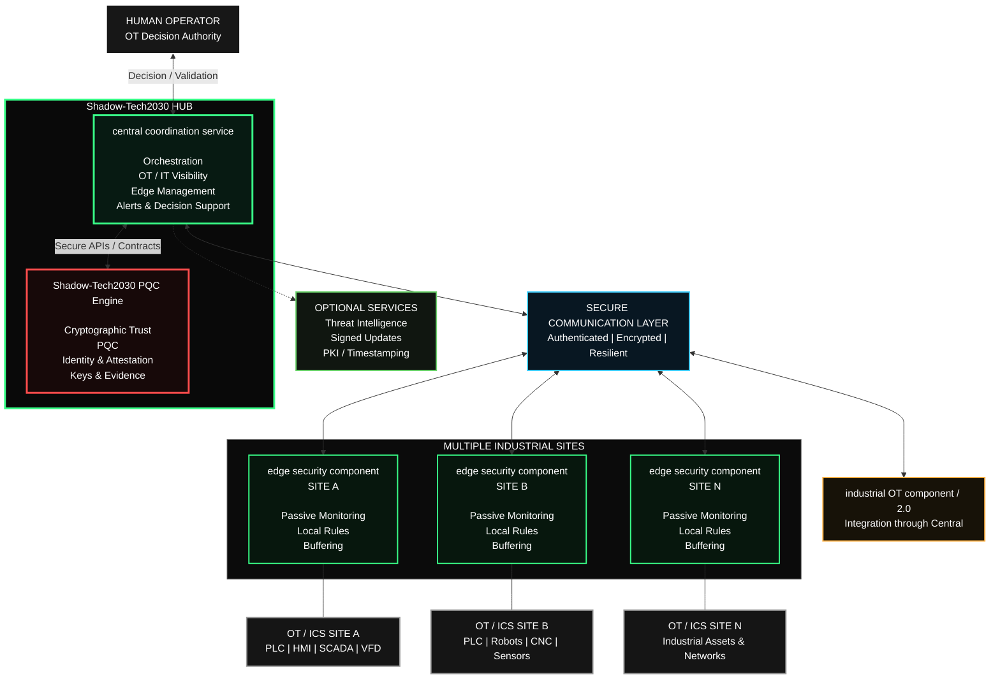

# Shadow-Tech2030 Architecture — Public Boundary

This diagram is intentionally high-level.

It describes the public authority and trust boundaries of the Shadow-Tech2030 ecosystem without exposing proprietary implementation details.

## Architecture principle

**central coordination service + Shadow-Tech2030 PQC Engine form the Shadow-Tech2030 HUB.**

The architecture deliberately separates:

- operational visibility;
- cryptographic trust;
- local Edge observation;
- human OT decision authority.

---

## central coordination service

central coordination service coordinates the operational side of the Shadow-Tech2030 ecosystem.

Its public responsibilities include:

- orchestration;
- Edge management;
- OT / IT visibility;
- policy distribution;
- alert aggregation;
- decision support;
- evidence coordination;
- integration with other Shadow-Tech2030 components.

Central is the main coordination point between the Shadow-Tech2030 HUB and distributed edge security component deployments.

---

## Shadow-Tech2030 PQC Engine

Shadow-Tech2030 PQC Engine is the cryptographic trust engine of the Shadow-Tech2030 ecosystem.

Its responsibilities include:

- identity validation;
- device and service attestations;
- post-quantum cryptography;
- cryptographic keys and certificates;
- trust-policy enforcement;
- evidence integrity;
- cryptographic guardrails;
- safe-local trust behavior when required.

Shadow-Tech2030 PQC Engine remains technically decoupled from central coordination service through defined APIs and contracts.

This separation allows the cryptographic trust layer to evolve independently from the operational OT layer.

---

## edge security component

Multiple edge security component stations can operate across separate industrial sites.

A edge security component deployment may provide:

- passive OT / IT observation;
- local visibility;
- local detection rules;
- local buffering;
- store-and-forward;
- continued observation during temporary communication loss.

Each edge security component reports its permitted observations, state and alerts to central coordination service.

---

## Industrial environments

edge security component is designed to observe industrial environments containing assets such as:

- PLCs;
- HMIs;
- SCADA systems;
- RTUs;
- DCS components;
- variable-frequency drives;
- industrial robots;
- CNC equipment;
- sensors;
- industrial network infrastructure.

The architecture is designed so Shadow-Tech2030 monitoring does not become part of the industrial control path.

---

## Secure communication layer

Communication between distributed Shadow-Tech2030 components is designed around:

- authentication;
- encryption;
- resilience;
- trust validation;
- controlled policy distribution.

The communication layer connects central coordination service with distributed edge security component deployments.

---

## Human-in-the-loop

Important OT remediation and operational decisions remain under human authority.

Shadow-Tech2030 PQC Engine may automatically enforce intrinsic cryptographic protections when trust cannot be established.

However, Quantum does **not** independently:

- stop a PLC;
- start a PLC;
- open or close a valve;
- modify PLC logic;
- change production setpoints;
- modify machine recipes;
- control an industrial process;
- replace the human operator.

The distinction is intentional:

> **central coordination service and edge security component understand the operational environment.**

> **Shadow-Tech2030 PQC Engine protects the cryptographic trust boundary.**

> **Human operators retain authority over significant OT decisions.**

---

## industrial OT component and IT component

industrial OT component and IT component can integrate with the broader Shadow-Tech2030 ecosystem through central coordination service.

This allows them to access HUB services while keeping Shadow-Tech2030 PQC Engine technically separated from their operational logic.

---

## Optional external services

The architecture may interact with optional external services such as:

- threat intelligence;
- signed software updates;
- PKI services;
- trusted timestamping;
- backup or replication services.

These services are not required to define the internal authority boundary of the Shadow-Tech2030 HUB.

---

## Public disclosure boundary

This document intentionally describes only the high-level architecture.

It does **not** disclose:

- Shadow-Tech2030 source code;
- proprietary algorithms;
- internal detection logic;
- cryptographic secrets;
- private keys;
- internal policy implementation;
- sensitive test vectors;
- detailed attack paths;
- customer or production information.

---

**Shadow-Tech2030 Inc.**

*Passive & Secure by Design*

https://shadowtech2030.ca
